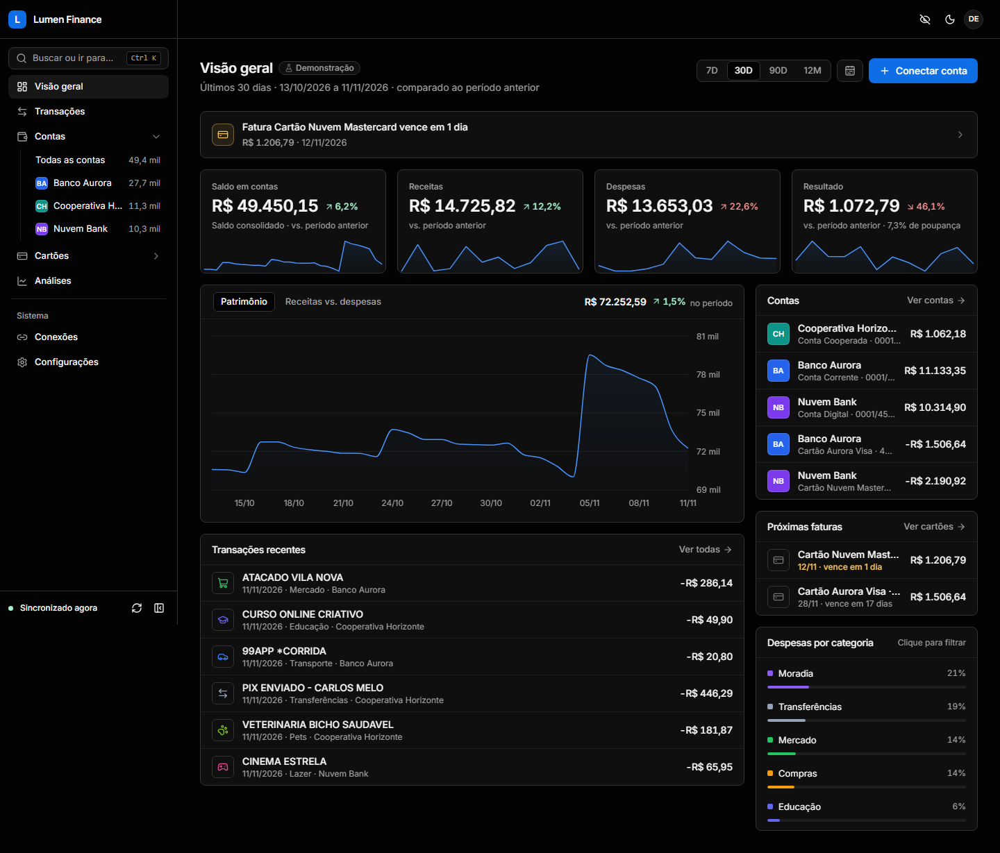
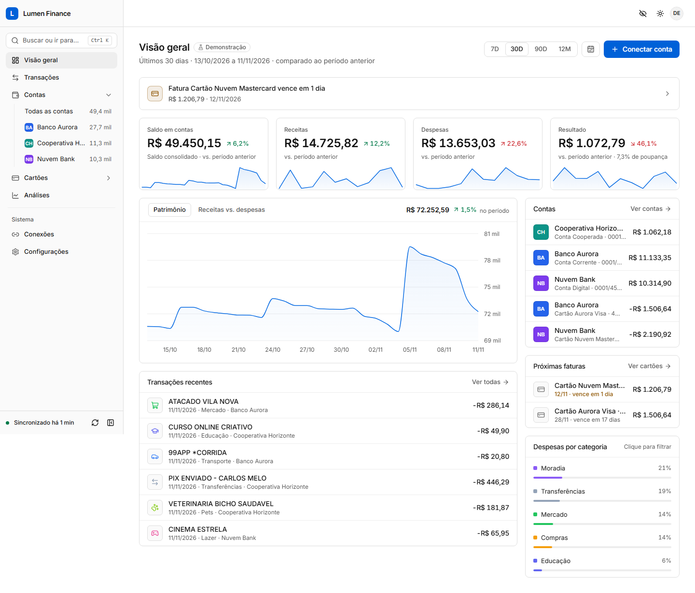
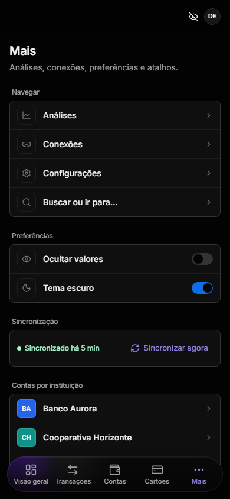
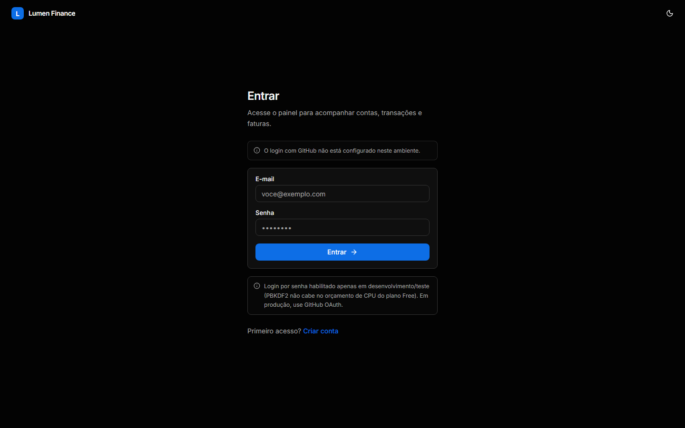

# Lumen Finance

Dashboard pessoal de finanças para o mercado brasileiro: contas, cartões, faturas, transações e investimentos em um só lugar, com dados em BRL e interface em pt-BR.

O projeto roda 100% nos planos gratuitos da Cloudflare (Workers, Pages, D1 e KV) e usa Open Finance via [Pluggy](https://pluggy.ai): **MeuPluggy** para ler os próprios dados reais em produção e sandbox para desenvolvimento. O provider de demonstração determinístico continua disponível apenas em dev/teste (a produção roda com `ENABLE_DEMO_PROVIDER=false`).

> **Status:** em desenvolvimento ativo. O design system, o shell autenticado, os contratos, o schema D1 e os providers já estão no repositório; a API REST e todas as telas de dados estão implementadas e prontas para produção no plano gratuito da Cloudflare (MeuPluggy para dados reais, login por GitHub OAuth com allowlist). A fonte da verdade de arquitetura e decisões é [`docs/architecture.md`](docs/architecture.md).

## Screenshots

| Visão geral (dark)                                                     | Visão geral (light)                                                    |
| ---------------------------------------------------------------------- | ---------------------------------------------------------------------- |
|  |  |

| Mobile                                                           | Login                                                     |
| ---------------------------------------------------------------- | --------------------------------------------------------- |
|  |  |

Mais capturas (transações, componentes e KPIs) em [`docs/screenshots/`](docs/screenshots/). Elas são geradas pelo Playwright; veja o comando em [`docs/design-system.md`](docs/design-system.md#screenshots-de-revisão).

## O que tem

- **Visão geral** com saldo consolidado, receitas, despesas, resultado e patrimônio, com comparativo de período.
- **Contas e transações** com filtros por período, conta, categoria e tipo; categorização e notas.
- **Cartões e faturas** com limite, fechamento, vencimento e transações da fatura.
- **Análises** de fluxo de caixa, categorias, evolução patrimonial e receitas x despesas por mês.
- **Investimentos** e composição do patrimônio.
- **Conexões** com o provider `pluggy`/MeuPluggy para dados reais; em dev/teste o provider `demo` pode ser habilitado e fica sempre identificado com o selo **Demonstração**.
- **Sincronização fatiada** do histórico (demo e Pluggy), com progresso por fatia e retomada automática pelo cron.
- **Responsivo**: transações em cartões virtualizados no mobile; gráficos e comparativo mensal sem rolagem horizontal.
- **Tema** dark por padrão, light opcional, persistido no navegador.
- **Autenticação** própria: GitHub OAuth em produção e senha apenas em desenvolvimento.

## Stack

| Camada                 | Tecnologias                                                                                                       |
| ---------------------- | ----------------------------------------------------------------------------------------------------------------- |
| Frontend (`apps/web`)  | React 19, Vite, TanStack Router / Query / Form / Table v9 / Virtual, Tailwind CSS v4, shadcn/ui, Recharts, Lucide |
| API (`apps/api`)       | Cloudflare Workers, Hono, Zod, Drizzle ORM sobre D1, KV e Cron Trigger                                            |
| Pacotes (`packages/*`) | `@fd/contracts`, `@fd/database`, `@fd/financial-providers`, `@fd/ui`, `@fd/config`                                |
| Infra                  | Cloudflare Pages + Pages Functions (service binding), Workers, D1, KV, GitHub Actions                             |
| Ferramentas            | pnpm 12, Turborepo, TypeScript 6.0.3, Vitest 5, Playwright, ESLint, Prettier                                      |

## Estrutura do monorepo

```
finance-dashboard/
├── apps/
│   ├── web/                    React + Vite; SPA servida pelo Pages
│   │   ├── functions/api/      Pages Function que encaminha /api/* para o Worker
│   │   └── e2e/                testes Playwright
│   └── api/                    Worker Hono; D1, KV e Cron Trigger
├── packages/
│   ├── contracts/              schemas Zod e DTOs compartilhados
│   ├── database/               schema Drizzle, migrations SQL e seed local
│   ├── financial-providers/    FinancialProvider + DemoProvider + PluggyProvider
│   ├── ui/                     utilitários e componentes compartilhados
│   └── config/                 tsconfig, ESLint e Prettier
├── docs/
│   ├── architecture.md         fonte da verdade (arquitetura e decisões)
│   ├── adr/                    decisões em formato ADR
│   ├── research/               pesquisa de suporte (Pluggy, auth, providers)
│   ├── screenshots/            capturas de tela versionadas
│   ├── local-development.md
│   ├── deploy.md
│   ├── environment-variables.md
│   └── open-finance.md
└── .github/workflows/          CI e deploy de produção
```

## Quick start local

Requisitos: **Node 24** (`.nvmrc`), **pnpm 12** (`corepack enable`), Git e um terminal. No Windows não é necessário Python.

```bash
pnpm install

# 1. variáveis locais (o modo demo funciona sem preencher nada)
cp apps/api/.dev.vars.example apps/api/.dev.vars

# 2. banco D1 local: migrations + usuário/categorias do seed
pnpm db:migrate:local
pnpm db:seed:local

# 3. sobe web (:5173) e API (:8787) juntos
pnpm dev
```

Abra `http://127.0.0.1:5173` e entre com o usuário demo:

- **E-mail:** `demo@finance.local`
- **Senha:** `demo1234`

Depois, em **Conexões**, você pode usar **Conectar demonstração** (somente dev/teste, sem secrets) para explorar o painel com dados fictícios. Para dados reais, preencha `PLUGGY_CLIENT_ID`/`PLUGGY_CLIENT_SECRET`/`PLUGGY_WEBHOOK_SECRET` em `apps/api/.dev.vars` e use **Conectar MeuPluggy**; o passo a passo está em [`docs/open-finance.md`](docs/open-finance.md#4-meupluggy-dados-reais-pessoais-produção).

No Windows, prefira `127.0.0.1` a `localhost`: o Vite é configurado em `127.0.0.1` para evitar a resolução para `::1`. Detalhes, reset do banco e troubleshooting em [`docs/local-development.md`](docs/local-development.md).

## Scripts

| Comando                                | O que faz                                                                    |
| -------------------------------------- | ---------------------------------------------------------------------------- |
| `pnpm dev`                             | Sobe web e API em modo desenvolvimento (Turborepo)                           |
| `pnpm build`                           | Build de produção do web e dry-run do Worker                                 |
| `pnpm lint`                            | ESLint em todos os pacotes                                                   |
| `pnpm typecheck`                       | `tsc --noEmit` em todos os pacotes                                           |
| `pnpm test`                            | Testes unitários (Vitest)                                                    |
| `pnpm test:e2e`                        | Smoke E2E com Playwright/Chromium                                            |
| `pnpm format` / `pnpm format:check`    | Prettier (escreve / verifica)                                                |
| `pnpm db:migrate:local`                | Aplica migrations no D1 local                                                |
| `pnpm db:seed:local`                   | Popula o D1 local (seed idempotente)                                         |
| `pnpm --filter @fd/api pluggy:webhook` | Registra/atualiza o webhook global do Pluggy (idempotente; veja os env vars) |

Comandos por pacote: `pnpm --filter @fd/web <script>` e `pnpm --filter @fd/api <script>`. O banco também aceita `pnpm --filter @fd/database db:generate` para gerar migrations com drizzle-kit.

## Testes

```bash
pnpm test        # unitários
pnpm test:e2e    # E2E; sobe API e web automaticamente
```

Na primeira vez, baixe o Chromium do Playwright:

```bash
pnpm --filter @fd/web exec playwright install chromium
```

O CI (`.github/workflows/ci.yml`) roda `format:check`, `lint`, `typecheck`, `test` e `build` (job `checks`, com cache do Turborepo) e `test:e2e` (job `e2e` em 2 shards, 2 workers cada, apenas Chromium) em paralelo, com cache do pnpm. O deploy é separado: roda sozinho quando o CI fica verde na `main` (`.github/workflows/deploy.yml`) e também aceita execução manual.

## Documentação

- [Arquitetura e decisões](docs/architecture.md) — contrato entre as frentes.
- [Desenvolvimento local](docs/local-development.md) — `.dev.vars`, portas, reset do D1, Windows.
- [Deploy no plano gratuito](docs/deploy.md) — D1, KV, Worker, Pages, OAuth, cron e webhook.
- [Variáveis, secrets e bindings](docs/environment-variables.md) — o que configurar e onde.
- [Open Finance](docs/open-finance.md) — MeuPluggy em produção, sandbox/dev, demonstração e novos providers.
- [ADRs](docs/adr/README.md) — decisões registradas em formato curto.
- [Design system](docs/design-system.md) — tokens, componentes e screenshots.
- [Pesquisa](docs/research/) — Pluggy API, auth em Workers e comparação de providers.

## Custo e segurança

O projeto não usa Workers Paid, Queues, R2 nem qualquer recurso que exija cartão. Os limites do plano Free e as escolhas que mantêm o app dentro deles estão em [`docs/deploy.md`](docs/deploy.md#limites-do-plano-free-e-como-o-app-se-mantém-dentro-deles); o checklist de produção está em [`docs/deploy.md`](docs/deploy.md#checklist-de-segurança).

O build do Pages inclui [`apps/web/public/_headers`](apps/web/public/_headers) com CSP, HSTS, `X-Content-Type-Options`, `Referrer-Policy` e `Permissions-Policy`; o mesmo arquivo é aplicado em `vite dev`/`vite preview` para validar a política localmente.

Nunca commite `.dev.vars`, tokens ou credenciais. O arquivo de exemplo é [`apps/api/.dev.vars.example`](apps/api/.dev.vars.example).
